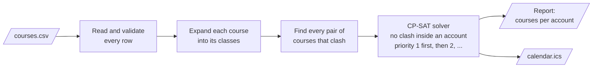

# course-schedule-optimizer

[](https://github.com/dbarretol/course-schedule-optimizer/actions/workflows/ci.yml)
[](LICENSE)


**Pick the best set of courses when you can enroll through more than one account.**

Many course platforms refuse to enroll one account in two courses whose schedules clash, but
nothing stops you from enrolling a second account in the other one. Recorded classes make this
common: you can follow two live schedules at once and watch one of them later.

Give this tool a CSV with your candidate courses, their schedules and how much you want each one.
It tells you which courses to take with each account so that **no account has a clash** and as
many high-priority courses as possible fit. It can also put the result in your calendar.

- [The idea in one picture](#the-idea-in-one-picture)
- [Quick start](#quick-start)
- [Writing your course file](#writing-your-course-file)
- [Commands](#commands)
- [How it works](#how-it-works)
- [Limitations](#limitations)
- [Contributing](#contributing)

## The idea in one picture

Three courses overlap on Monday evening. One account could take only one of them; with two
accounts you can take two, and the tool keeps the two with the highest priority:

```mermaid
gantt
    title Monday evening, two accounts
    dateFormat HH:mm
    axisFormat %H:%M
    section Account 1
    Intro to Python · priority 1     :done, 18:00, 21:00
    section Account 2
    Data Visualization · priority 2  :done, 19:00, 22:00
    section Not taken
    Public Speaking · priority 4     :crit, 20:00, 22:00
```



*Public Speaking clashes with both accounts, and it has the lowest priority, so it is left out.*

Priorities are strict: the tool never gives up a priority-1 course to fit any number of
lower-priority ones. Among equally good choices it always returns the same answer.

## Quick start

Requires Python 3.12+ and [uv](https://docs.astral.sh/uv/).

```bash
git clone https://github.com/dbarretol/course-schedule-optimizer.git
cd course-schedule-optimizer
uv sync
uv run course-scheduler solve examples/courses.sample.csv
```

Output (abridged):

```text
ACCOUNT 1 (4 courses):
  [1] Intro to Python (priority 1)
  [2] SQL Fundamentals (priority 1)
  [4] Linux Basics (priority 2)
  [6] Project Management (priority 3)

ACCOUNT 2 (3 courses):
  [3] Data Visualization (priority 2)
  [5] Cloud Essentials (priority 3)
  [7] Git Workshop (priority 4)

UNASSIGNED COURSES (1):
  [8] Public Speaking (priority 4)

CLASHES (5 pairs):
  - Intro to Python <-> Data Visualization
  - Intro to Python <-> Git Workshop
  ...
```

Then export the chosen courses to a calendar you can import into Google Calendar, Outlook or
Apple Calendar:

```bash
uv run course-scheduler export-ics examples/courses.sample.csv --assigned-only -o calendar.ics
```

## Writing your course file

A `;`-separated CSV (UTF-8 or Windows-1252), one row per weekly block. This is
[`examples/courses.sample.csv`](examples/courses.sample.csv):

```text
course_id;name;start_date;days;start_time;end_time;total_hours;priority
1;Intro to Python;02/03/2026;Monday, Wednesday;18:00;21:00;24;1
2;SQL Fundamentals;03/03/2026;Tuesday;19:00;22:00;12;1
3;Data Visualization;02/03/2026;Monday;19:00;22:00;15;2
4;Linux Basics;07/03/2026;Saturday;09:00;13:00;16;2
5;Cloud Essentials;07/03/2026;Saturday;11:00;14:00;12;3
6;Project Management;05/03/2026;Thursday;18:00;20:00;10;3
6;Project Management;05/03/2026;Friday;18:00;21:00;10;3
7;Git Workshop;04/03/2026;Wednesday;19:30;21:30;5;4
8;Public Speaking;02/03/2026;Monday;20:00;22:00;8;4
```

| Column | Meaning | Example |
|---|---|---|
| `course_id` | Identifier. Rows sharing an id are **one course** with several weekly blocks (see course 6). | `6` |
| `name` | Course name. | `Project Management` |
| `start_date` | Date of the first class, `DD/MM/YYYY` or `YYYY-MM-DD`. | `05/03/2026` |
| `days` | Weekdays of this block. Separate with `,`, `/` or `and`; full or short names. | `Monday, Wednesday` · `Mon/Wed` |
| `start_time`, `end_time` | Time of this block, 24-hour `HH:MM`. | `18:00` |
| `total_hours` | Length of the whole course in hours, **not** the number of classes. | `24` |
| `priority` | Positive integer; `1` is the most wanted. | `1` |

How the file is read:

- Classes are generated from `start_date` onwards, block by block, until `total_hours` is
  reached; the last class is shortened if needed. *Intro to Python* (24 h, Monday and Wednesday
  18:00–21:00) becomes 8 classes.
- A class that ends exactly when another starts is **not** a clash.
- All rows of one course must have the same `name` and `priority`.
- If anything is wrong, nothing is solved: every problem is listed with its line number.

> Spanish headers (`ID Curso;Curso;Inicio;Días;Hora inicio;Hora fin;Horas;Prioridad`) and
> Spanish day names (`Lunes y Miércoles`) are accepted too.

## Commands

```bash
uv run course-scheduler solve      COURSES.csv [options]   # choose courses per account
uv run course-scheduler export-ics COURSES.csv [options]   # write an .ics calendar
```

| Option | Commands | Default | Description |
|---|---|---|---|
| `--accounts N` | both | `2` | Number of accounts. |
| `--timeout S` | both | `60` | Solver time limit in seconds. |
| `-o PATH`, `--output PATH` | both | none / `calendar.ics` | Also save the report (`solve`) or the calendar file (`export-ics`). |
| `-v`, `--verbose` | both | off | `solve` also shows, per chosen course, its number of classes and first/last date; more detailed logs. |
| `--assigned-only` | `export-ics` | off | Export only the courses chosen by `solve`, tagged *Account 1*, *Account 2*… |
| `--sessions-csv PATH` | `export-ics` | none | Also write one CSV row per class. |
| `--delimiter C` | both | `;` | CSV delimiter. |
| `--log-file PATH` | both | none | Also write logs to a file. |

Exit codes: `0` success · `1` no solution found within the time limit · `2` invalid input.
Run `uv run course-scheduler <command> --help` for details.

## How it works



1. **Read**: each row is checked (dates, days, times, hours, priority) and rows with the same
   `course_id` are merged into one course.
2. **Expand**: weekly blocks become dated classes until the course's total hours are covered.
3. **Clash**: two courses clash if any class of one overlaps any class of the other.
4. **Solve**: [Google OR-Tools CP-SAT](https://developers.google.com/optimization/cp/cp_solver)
   assigns each course to at most one account, never putting two clashing courses in the same
   account, and maximizes priority-1 courses first, then priority 2, and so on.
5. **Output**: a text report, and optionally an iCalendar file.

The mathematical model, including how the priority weights are chosen, is described in
[docs/model.md](docs/model.md).

## Limitations

- Designed for personal use: up to ~50 courses solve within about a second.
- Times are written to the calendar as local times without a time zone, exactly as in the CSV.
- Every class of a course is assumed to need the same account; a course cannot be split.
- Priorities are strict. There is no "two priority-2 courses are worth one priority-1" trade-off.

## Contributing

Bug reports and pull requests are welcome. See [CONTRIBUTING.md](CONTRIBUTING.md) for the
development setup and checks, and [CHANGELOG.md](CHANGELOG.md) for release notes.

## License

[MIT](LICENSE)
